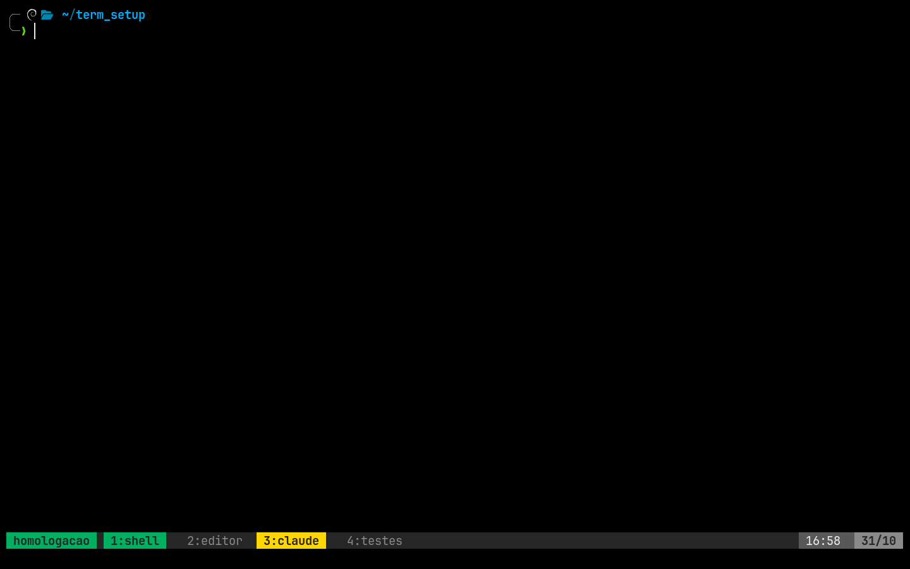
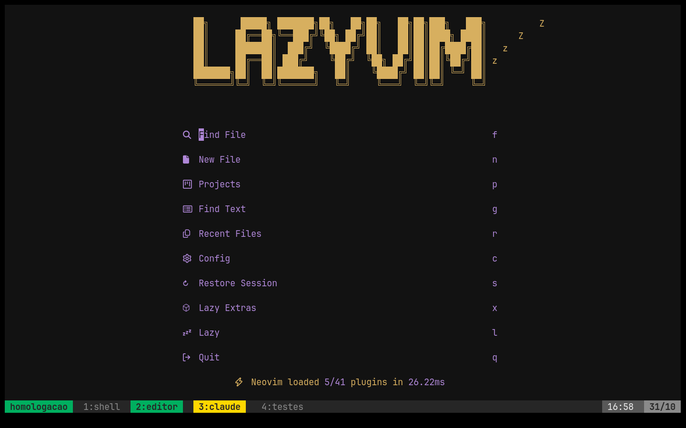

# Setup de terminal para Debian e Ubuntu

Este repositório transforma o ambiente atual em um setup portátil, centrado no terminal:

| Camada | Ferramenta | Papel |
| --- | --- | --- |
| Terminal gráfico | Alacritty | Abre a janela e renderiza a fonte/cores. |
| Shell | Zsh + Oh My Zsh + Powerlevel10k | Prompt, completions e comandos. |
| Multiplexador | tmux | Mantém sessões, painéis e histórico vivos. |
| Editor/IDE | Neovim + LazyVim | Edição, LSP, busca, diagnósticos e plugins. |
| Agente | Codex | Inspeção, implementação, testes e revisão no diretório do projeto. |

O diretório `config/` é a fonte de verdade. O arquivo `install.sh` instala ferramentas e copia essas configurações para a home do usuário. Ele não altera o repositório de origem nem atualiza automaticamente instalações já existentes do Oh My Zsh ou de plugins.

## O que foi preservado do computador atual

- Zsh com Oh My Zsh, tema Powerlevel10k, `git`, `zsh-autosuggestions` e `zsh-syntax-highlighting`.
- Seu prompt completo em `config/zsh/.p10k.zsh`, incluindo ícones Nerd Font e layout atual.
- tmux com mouse, histórico de 50 mil linhas, índices a partir de 1, modo de cópia Vim e integração com `wl-copy`.
- Notificações por sino (BEL): no tmux, uma janela em segundo plano que recebe `\a` tem a guia pintada de **amarelo** na barra (assim como a selecionada fica verde) até você entrar nela. Sem ícones nem pop-ups. Os hooks `Stop` e `Notification` do Claude Code (`config/claude/hooks.json`) enviam esse BEL para o painel certo quando o agente termina ou pede permissão. O instalador **mescla** esses hooks em `~/.claude/settings.json` (com backup) sem apagar suas outras preferências nem duplicar hooks.
- Alacritty com JetBrainsMono Nerd Font, tamanho 14, fundo preto e a paleta atual.
- LazyVim, o lockfile de plugins, TokyoDark, realces para Python e `venv-selector`.



*Guia `1:shell` selecionada (verde) e `3:claude` pedindo atenção (amarelo), porque o Claude Code terminou a tarefa nessa janela. Ao entrar nela, a guia volta ao cinza.*

<!-- PRINT: Alacritty no seu desktop real com tmux + Claude Code rodando.
     Salve como docs/img/desktop.png e troque este comentário por:
      -->

Havia dois formatos de configuração do Alacritty no computador: `alacritty.toml` e `alacritty.yml`, com cores diferentes. Só o TOML foi versionado, pois é o formato atual e o Alacritty recente o prioriza. O YAML foi propositalmente deixado de fora. Também alinhei a declaração global do tema do Neovim para `tokyodark`, que já era o tema efetivamente escolhido pelo plugin.

## Requisitos e limitações

O setup é **leve**: são ferramentas de terminal, sem serviços em segundo plano nem ambiente gráfico extra. Medido num Debian 13 mínimo:

| Recurso | Necessário | Detalhe |
| --- | --- | --- |
| Sistema | Debian, Ubuntu ou derivada com `apt` | `x86_64` ou `arm64` |
| Permissão | `sudo` | só para os pacotes do sistema |
| Internet | só na primeira execução | pacotes, Neovim, fonte e plugins |
| Disco | ~1 GB num sistema mínimo, bem menos num desktop comum | ~500 MB de pacotes apt (a maioria, como git, curl e python3, já vem num desktop) + ~540 MB na home: fonte 220 MB, plugins do Neovim 170 MB, Neovim 40 MB, Oh My Zsh 20 MB |
| RAM | nada além do normal | tmux ~20 MB, Neovim ~45 MB, cada zsh ~20 MB |
| Tempo | ~3–5 min | depende da internet; a maior parte é download |
| Docker | **não** | só se quiser usar a homologação opcional |

Detalhes:

- Distribuições: Debian, Ubuntu ou derivadas com `apt` (Linux Mint e outras, detectadas pelo `ID_LIKE` do `/etc/os-release`). Homologado em Debian 12/13, Ubuntu 22.04/24.04 e Linux Mint 22.1.
- No Ubuntu 22.04 não existe pacote `alacritty` no apt: o instalador avisa e segue sem ele (veja o [guia oficial](https://github.com/alacritty/alacritty/blob/master/INSTALL.md) para instalar por outro meio).
- Arquiteturas do Neovim: `x86_64` e `aarch64/arm64`.
- É necessária internet na primeira execução para pacotes, Oh My Zsh, plugins, fonte e Neovim.
- O script pede `sudo` apenas para pacotes do sistema. Oh My Zsh, fonte, Neovim e dotfiles ficam na sua home.
- A cópia no tmux está configurada para Wayland (`wl-copy`). Em uma sessão X11, ajuste a linha `copy-pipe-and-cancel` de `config/tmux/tmux.conf` para `xclip -selection clipboard` se necessário.

## Instalação em um computador novo

Publique este repositório no seu Git remoto privado e, no computador novo:

```bash
git clone <url-do-seu-repositorio> ~/src/ia_setup
cd ~/src/ia_setup
bash ./install.sh --dry-run
bash ./install.sh
```

Só isso já basta. Se quiser conferir antes se a máquina tem as dependências, ou ver o setup funcionando num container sem instalar nada, veja [Opcional: verificar e testar antes de instalar](#opcional-verificar-e-testar-antes-de-instalar).

O `--dry-run` mostra as ações sem instalar ou copiar nada. Na execução real, a única ação interativa extra é `chsh`, caso o Zsh ainda não seja seu shell de login. Feche e reabra o terminal ao final, ou execute:

```bash
exec zsh
```

Opções úteis:

```bash
bash ./install.sh --skip-chsh          # não muda o shell de login
bash ./install.sh --skip-nvim-sync     # não baixa plugins do LazyVim agora
bash ./install.sh --dry-run             # apenas simula
```

Os plugins do LazyVim são instalados exatamente nas versões de `config/nvim/lazy-lock.json` (`Lazy! restore`); para atualizá-los, use `:Lazy update` e versione o novo lockfile.

O Neovim `v0.11.5` é instalado em `~/.local/opt/nvim-v0.11.5` e exposto como `~/.local/bin/nvim`. Isso evita a versão geralmente antiga do `apt` e atende aos requisitos do LazyVim. O `.zshrc` inclui `~/.local/bin` no `PATH`.

### Segurança ao aplicar novamente

O instalador é idempotente para as configurações deste repositório:

- se o arquivo de destino for igual ao versionado, ele não é tocado;
- se for diferente, uma cópia é criada em `~/.config-backups/terminal-setup/<data-hora>/` antes da substituição;
- arquivos adicionais que você tenha em `~/.config/nvim` não são removidos;
- clones existentes em `~/.oh-my-zsh` são preservados, não recebem `git pull` automático.

Para restaurar um arquivo, copie a versão correspondente do diretório de backup de volta para a home. Antes de aplicar em uma máquina com dotfiles importantes, leia o `--dry-run`.

## Opcional: verificar e testar antes de instalar

> **Nada desta seção é necessário para instalar.** O caminho normal é só `bash ./install.sh` (seção acima). O verificador e a homologação em Docker existem apenas para quem quer **ver antes** como o setup fica, ou confirmar que a máquina tem tudo, sem tocar no sistema.

### 1. Verificar dependências (leve, sem Docker, nada é alterado)

```bash
bash scripts/check-deps.sh      # ou: bash ./install.sh --check | make check
bash scripts/check-deps.sh --json
```

Exemplo em uma máquina Debian 13 recém-instalada (trecho):

```text
SISTEMA
  ✔ distribuição                Debian GNU/Linux 13 (trixie)
  ✔ internet                    github.com:443 acessível
PACOTES
  ✔ ca-certificates             20250419+deb13u1
  + git                         apt-get install
  + tmux                        apt-get install
  + alacritty                   apt-get install (opcional: pulado se não existir no apt)
FERRAMENTAS
  + neovim                      será instalado em ~/.local/opt
  + JetBrainsMono Nerd Font     será baixada para ~/.local/share/fonts
AMBIENTE
  ! sessão gráfica              nenhuma detectada (SSH/container): ...

Resumo: 7 ok, 24 a instalar, 1 avisos (0 dotfiles com backup), 0 bloqueios
Pode instalar: bash ./install.sh --dry-run && bash ./install.sh
```

Mostra o que já existe (✔), o que o instalador vai instalar (+), avisos (!) — como dotfiles que receberão backup ou sessão X11 — e bloqueios (✘), como distro não suportada ou sem internet. Não usa `sudo`. Códigos de saída: `0` tudo presente, `1` faltam itens que o instalador resolve, `2` há bloqueio.

A lista de pacotes apt fica em `packages.txt`, usada tanto pelo instalador quanto pelo verificador.

### 2. Homologar em Docker (opcional e mais pesado; nada é instalado na sua máquina)

É bem mais pesado que o setup em si, porque cada distro testada vira uma imagem com o setup completo dentro. Requisitos mínimos **só para a homologação**:

| | Mínimo | Observação |
| --- | --- | --- |
| Docker | 20.10+ com BuildKit (padrão desde 23.0) | ou `make DOCKER=podman …` |
| Disco | ~2,5 GB livres (~3 GB com o modo gráfico) | por distro testada |
| RAM | 1 GB livre (2 GB no modo gráfico) | o modo gráfico usa ~200 MB parado |
| Internet | obrigatória | baixa pacotes, Neovim, fonte e plugins |
| Tempo | ~3–5 min por distro na primeira vez | depois o cache do Docker acelera |
| `make` | opcional | os comandos `docker` equivalentes estão no `Makefile` |

```bash
make test                         # homologação automática na distro padrão (debian:13)
make test DISTRO=ubuntu:24.04     # outra distro
make test-all                     # todas as distros de DISTROS
make try                          # terminal interativo já instalado (tmux + zsh + nvim)
make try-gui                      # Alacritty de verdade no navegador
make clean                        # apaga as imagens de homologação
```

O `make test` sobe um container limpo, com um usuário comum com `sudo`, e roda `test/smoke.sh`:

1. `check-deps.sh` antes da instalação (precisa acusar o que falta);
2. `install.sh --dry-run` não pode criar nenhum arquivo na home;
3. `install.sh --skip-chsh` real;
4. `check-deps.sh` de novo (tudo presente);
5. smoke tests: zsh carrega sem erros com Powerlevel10k, Neovim ≥ 0.11 abre headless, fonte registrada, `fd`;
6. notificações: BEL numa janela de fundo do tmux pinta a guia de amarelo e os hooks do Claude Code foram mesclados;
7. idempotência: uma segunda execução não pode gerar backups.

`SKIP_NVIM_SYNC=1 make test` pula o download dos plugins do LazyVim (mais rápido).

**Modo gráfico (`make try-gui`).** Abre um desktop virtual (Xvfb + noVNC) com o Alacritty rodando tmux.

<!-- PRINT: navegador em http://localhost:6080 mostrando o Alacritty do `make try-gui`.
     Salve como docs/img/try-gui.png e troque este comentário por:
      -->
 Acesse <http://localhost:6080/vnc.html?autoconnect=1&resize=remote> — a porta só escuta em `127.0.0.1`. É a única forma de ver fonte, cores e a barra do tmux como ficarão no PC. Peso medido (Debian 13, sem compressão):

| Imagem | Tamanho | Uso |
| --- | --- | --- |
| `base` | ~200 MB | `make test` (a instalação acontece durante o teste) |
| `installed` | ~1,8 GB | `make try` — é o tamanho real do setup instalado (build-essential, Neovim, plugins, fonte) |
| `gui` | ~2,4 GB | `make try-gui` — **+~580 MB** sobre a `installed` (Xvfb, VNC, noVNC, Mesa) |

Ou seja, o modo gráfico adiciona cerca de um terço ao tamanho, e só é construído quando você roda `make try-gui`. A renderização é por software (sem GPU), então pode parecer um pouco mais lenta que no PC real.

**O que o Docker não cobre:** `chsh` (o container usa `--skip-chsh`), clipboard via Wayland (`wl-copy`), aceleração de GPU e systemd.

#### Adicionar outra distro

Qualquer imagem Docker baseada em Debian/Ubuntu funciona como `DISTRO`. Exemplo com Linux Mint (imagens oficiais em `linuxmintd/*`):

```bash
make test DISTRO=linuxmintd/mint22.1-amd64        # Mint 22.1 (base Ubuntu 24.04)
make try  DISTRO=linuxmintd/mint21.3-amd64        # Mint 21.3 (base Ubuntu 22.04)
```

Para incluí-la sempre no `make test-all`, acrescente a imagem em `DISTROS` no `Makefile`:

```make
DISTROS ?= debian:12 debian:13 ubuntu:22.04 ubuntu:24.04 linuxmintd/mint22.1-amd64
```

ou só na hora: `make test-all DISTROS="debian:13 linuxmintd/mint21.3-amd64 linuxmintd/mint22.1-amd64"`.

Se a distro não for derivada de Debian/Ubuntu (não tiver `debian` ou `ubuntu` em `ID`/`ID_LIKE` no `/etc/os-release`), o verificador acusa bloqueio e o instalador recusa — isso é esperado.

## Arquivos instalados

```text
config/zsh/.zshrc                 -> ~/.zshrc
config/zsh/.p10k.zsh              -> ~/.p10k.zsh
config/tmux/tmux.conf             -> ~/.tmux.conf
config/alacritty/alacritty.toml   -> ~/.config/alacritty/alacritty.toml
config/nvim/**                    -> ~/.config/nvim/**
config/claude/hooks.json          -> mesclado em ~/.claude/settings.json
packages.txt                      -> pacotes apt (instalador e verificador)
```

Além disso, o script instala Zsh, tmux, Alacritty, Git, Curl, Ripgrep, FZF, `fd-find`, Python/venv, ferramentas de compilação, fontes e utilitários de clipboard. No Debian/Ubuntu, `fd-find` fornece o binário `fdfind`; o instalador cria `~/.local/bin/fd` para compatibilidade com ferramentas que esperam o nome `fd`.



## Primeiro diagnóstico

Depois de abrir outro terminal, execute:

```bash
zsh --version
tmux -V
nvim --version
fc-match 'JetBrainsMono Nerd Font'
nvim +checkhealth
```

No Neovim, estes comandos ajudam a identificar problemas:

```vim
:Lazy
:Mason
:checkhealth
```

`Lazy` mostra e atualiza plugins; `Mason` administra servidores LSP, formatadores e debuggers. Para projetos Python, crie `.venv` ou `venv` na raiz e use `<Space>vs` para escolher o ambiente virtual. `<Space>vc` reutiliza a escolha salva.

## Fluxo diário no terminal

Abra um projeto dentro de uma sessão persistente:

```bash
cd ~/codigo/meu-projeto
tmux new -As meu-projeto
nvim .
```

Alguns atalhos padrão do tmux configurado aqui:

| Ação | Atalho |
| --- | --- |
| Criar janela | `Ctrl-b c` |
| Dividir verticalmente | `Ctrl-b %` |
| Dividir horizontalmente | `Ctrl-b "` |
| Navegar entre painéis | `Ctrl-b` e seta, ou `Ctrl-b o` |
| Entrar no modo de cópia | `Ctrl-b [` |
| Selecionar/copiar no modo de cópia | `v`, depois `y` |
| Desanexar sem encerrar | `Ctrl-b d` |
| Retomar sessão | `tmux attach -t meu-projeto` |

Uma disposição simples que funciona bem é: editor em um painel grande, servidor/testes em outro e Codex em uma janela própria. O tmux mantém tudo rodando mesmo se você fechar o Alacritty ou trocar de terminal.

## Como colaborar bem com Codex

Entre no diretório do repositório antes de iniciar o Codex. O agente consegue então examinar os arquivos relevantes, entender a estrutura e executar os testes que já existem. Para tarefas maiores, descreva objetivo, restrições e como saber que terminou.

Bom pedido:

```text
No módulo de autenticação, adicione login por token. Preserve a API atual,
escreva testes de sucesso e erro, execute a suíte relevante e mostre os arquivos alterados.
```

Pedidos úteis para cada fase:

- Explorar: “Leia este repositório e explique o fluxo de criação de usuários. Não altere arquivos.”
- Planejar: “Proponha um plano curto para migrar X; aponte riscos antes de editar.”
- Implementar: “Implemente o plano, mantenha a compatibilidade e execute os testes Y.”
- Revisar: “Revise o diff atual em busca de bugs, regressões e lacunas de teste; não altere nada.”
- Diagnosticar: “Reproduza a falha, encontre a causa e explique-a; não aplique correção ainda.”

O detalhe que mais melhora o resultado é explicitar o limite de autonomia: diga “apenas leitura”, “não altere dependências”, “não faça push”, “pode editar e testar” ou “pare antes de qualquer migração”. Para mudanças com impacto maior, peça um plano antes da implementação; para tarefas pequenas e bem delimitadas, peça diretamente a mudança e o teste. A [documentação oficial de casos de uso do Codex](https://developers.openai.com/codex/use-cases) também reúne exemplos de análise de repositórios, automação e revisão.

## Atualização e manutenção

Edite sempre o arquivo dentro de `config/`, não somente o arquivo em `~`. Em seguida reaplique:

```bash
cd ~/src/ia_setup
git pull
bash ./install.sh --skip-chsh
```

Para atualizar plugins manualmente no Neovim, use `:Lazy update`. Isso altera `lazy-lock.json`; revise e faça commit desse lockfile se quiser que a próxima máquina receba exatamente as mesmas versões. Para reinstalar as versões já travadas, rode:

```bash
nvim --headless '+Lazy! sync' +qa
```

Se você personalizar a configuração diretamente na home, traga a mudança de volta ao repositório antes de trocar de PC. Exemplos:

```bash
cp ~/.tmux.conf config/tmux/tmux.conf
cp ~/.config/alacritty/alacritty.toml config/alacritty/alacritty.toml
cp -a ~/.config/nvim/. config/nvim/
```

Revise o diff e faça commit:

```bash
git diff
git add config install.sh README.md
git commit -m 'Atualiza setup de terminal'
```

## Solução de problemas

| Sintoma | Causa provável | Ação |
| --- | --- | --- |
| Ícones quebrados no prompt | Fonte Nerd Font ausente ou Alacritty não reiniciado | Rode `fc-match 'JetBrainsMono Nerd Font'`, reabra o Alacritty. |
| `nvim` abre uma versão antiga | `~/.local/bin` não está no PATH da sessão atual | `exec zsh`; depois `command -v nvim`. |
| `y` do tmux não copia | `wl-copy` requer sessão Wayland | Use Wayland ou troque por `xclip` conforme descrito acima. |
| Plugins não baixaram | Rede ou execução com `--skip-nvim-sync` | Rode `nvim --headless '+Lazy! sync' +qa`. |
| Prompt do Zsh não aparece | Tema Powerlevel10k não foi clonado | Confirme `~/.oh-my-zsh/custom/themes/powerlevel10k`. |
| Alacritty não abre em servidor/headless | Ele requer uma sessão gráfica | Use tmux e Neovim no terminal disponível. |

## O que não entra neste repositório

Não foram copiados credenciais, chaves SSH, configurações de Git com nome/e-mail, tokens, perfis de cloud nem a instalação do NVM. Mantenha esses itens em um gerenciador de segredos ou em um processo separado. O `.zshrc` continua compatível com NVM quando ele já estiver instalado, mas não instala Node automaticamente.

